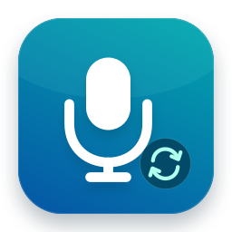

<p align="center">
  
</p>

# Mic Cycle

A menu bar app for choosing the default microphone on macOS, with a global shortcut to cycle through inputs.

[](https://github.com/EcossAIah/mic-cycle/releases)
[](LICENSE)


## Why

Switching microphones in macOS means opening System Settings > Sound > Input.
Mic Cycle puts the list one click away in the menu bar, and Control+Option+M
moves to the next input from anywhere. A switch is reported as successful only
after macOS reads back the new device.

## Install

1. Download `mic-cycle-1.3.0.zip` from [Releases](https://github.com/EcossAIah/mic-cycle/releases).
2. Unzip it and drag **Mic Cycle.app** to `/Applications`.
3. Open it. A microphone icon appears in the menu bar. There is no Dock icon.

The app is ad-hoc signed, not notarized, so Gatekeeper blocks the first launch.
On macOS 15 and later, try to open it once, then go to
**System Settings > Privacy & Security** and click **Open Anyway**.
On macOS 13 and 14, Control-click the app and choose **Open**.
If you prefer not to do this, build from source (below).

The release build is for Apple silicon. On an Intel Mac, build from source.

When upgrading, quit the running copy before replacing it.

## Usage

- Click the menu bar icon to see the inputs that can be the system default.
  A checkmark marks the current one. Click another to switch.
- Press **Control+Option+M** anywhere, or choose **Next Microphone** in the menu,
  to switch to the next input. The order is alphabetical and wraps around.
- A small panel near the top of the screen confirms each switch, or explains why it failed.
- The list updates on its own when devices connect, disconnect, or are changed by another app.
- **Copy Diagnostics** copies the device list, each device's eligibility, and the
  last error to the clipboard. Paste it into an issue if switching fails.
- **Quit Mic Cycle** (Command+Q while the menu is open) exits the app.

## Permissions and privacy

- Mic Cycle changes the system default input device. That is all it changes.
- It does not record or read audio, so macOS does not ask for microphone access.
- The global shortcut uses the Carbon hotkey API, which needs no Accessibility permission.
- It makes no network connections and stores no settings or data on disk.
- The clipboard is written only when you choose Copy Diagnostics.

## Build from source

Requirements: macOS 13 or later and Xcode or the Command Line Tools
(`xcode-select --install`). No Xcode project or third-party packages are used.

```sh
git clone https://github.com/EcossAIah/mic-cycle.git
cd mic-cycle
./build-app.sh
open "build/Mic Cycle.app"
```

`build-app.sh` compiles `App/*.swift` with `swiftc -O` for the host architecture,
strips symbols, writes `Info.plist`, bundles the icon, and ad-hoc signs the result.

`./package-release.sh` runs the build and writes `build/mic-cycle-<version>.zip`
with its SHA-256 checksum. That zip is what Releases publishes.

Run the tests:

```sh
./test-core-audio.sh --logic-only   # no hardware needed, changes nothing
./test-core-audio.sh                # also switches real inputs, then restores the original
```

See [docs/TESTING.md](docs/TESTING.md) for what each test covers.

To regenerate the icon after editing `Tools/generate-icon.swift`:

```sh
swift Tools/generate-icon.swift
```

## How it works

- `CoreAudioClient` talks to the Core Audio HAL. An input is listed when it is
  alive, has input channels, and reports `kAudioDevicePropertyDeviceCanBeDefaultDevice`
  for the input scope. Devices that cannot be the default are hidden.
- Switching sets `kAudioHardwarePropertyDefaultInputDevice`, then polls the value
  every 50 ms for up to two seconds. The switch counts as done only when the
  readback matches. An accepted write alone is never shown as success.
- `AudioDeviceStore` registers property listeners on the device list, the default
  input, and each device's name, liveness, eligibility, and stream configuration,
  so the menu stays current.
- `GlobalHotKey` registers Control+Option+M with `RegisterEventHotKey`.
- The UI is a SwiftUI `MenuBarExtra`. `LSUIElement` keeps the app out of the Dock.

## Command-line extra

`Extras/NextMicrophone.swift` is the small CLI this app grew from. It lists inputs
(`--list`) or switches to the next one, without the app's eligibility checks or readback.

```sh
mkdir -p build/module-cache
xcrun swiftc -module-cache-path build/module-cache -O -framework CoreAudio \
  Extras/NextMicrophone.swift -o build/next-microphone
```

## Limitations

- The shortcut is fixed to Control+Option+M. If another app holds it, the menu
  shows an error and the device list still works. Free the shortcut and restart Mic Cycle.
- Apps that pick a specific microphone in their own settings ignore the system default.
- There is no launch-at-login option. Add the app under
  **System Settings > General > Login Items** if you want it.
- Not notarized. The release zip is Apple silicon only.
- Live switching and hotkey delivery are not covered by CI; they need real audio hardware.

## License

[MIT](LICENSE)
